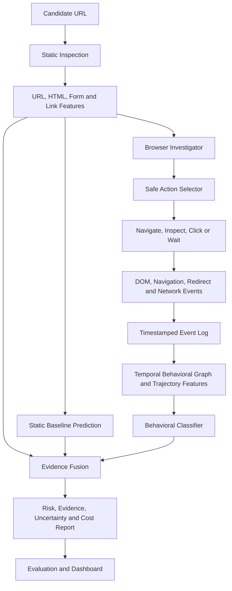

# Research Blueprint: Budget-Aware Active Browser Investigation for Phishing Detection Using Temporal Behavioral Graphs

**Target venue:** ICTCS 2026 — Track 1: ICT for Infrastructure and Computation  
**Research area:** Network and information security, temporal reasoning, data fusion, scalability and robustness  
**Status:** Proposed research plan. No experimental results are claimed in this document.

---

## 1. Final research direction

### Recommended title

**Budget-Aware Active Browser Investigation for Phishing Detection Using Temporal Behavioral Graphs**

### Research premise

Many phishing detectors classify a URL or an initial webpage snapshot. These signals can be insufficient when suspicious behavior appears only after navigation, interaction, a delayed page update, or a redirect. Browser automation can gather more evidence, but exhaustive exploration is expensive and may expose the investigator to unsafe actions.

This work proposes a resource-bounded browser investigation method that selects safe, informative browser actions, records time-ordered webpage events as a temporal behavioral representation, and combines static and dynamic evidence to classify a website.

The central claim to test is:

> Under a fixed browser-action or time budget, can adaptive browser investigation detect more phishing behavior than static analysis and fixed-sequence exploration, while keeping false positives and investigation cost under control?

This is a hypothesis, not an established result. The project must validate it experimentally.

### Why this topic fits ICTCS Track 1

The project aligns with:
- Network and information security.
- Temporal reasoning and event-sequence analysis.
- Data fusion across URL, DOM, navigation and network evidence.
- Efficient computation under a limited action budget.
- Robustness, reliability and explainable system outputs.

The contribution should be framed as a measurable detection and resource-efficiency method, not simply a browser automation application.

---

## 2. Scope: what to implement and what to defer

### Core implementation

1. URL and initial-page feature extraction.
2. Isolated browser execution using Playwright.
3. Safe observation of DOM changes, navigation, redirects, forms and network destinations.
4. A timestamped event log and temporal behavioral graph.
5. Three comparable detection modes: static, fixed exploration and adaptive exploration.
6. An adaptive action-selection policy using estimated information gain or uncertainty reduction minus action cost.
7. An evidence-fusion classifier and explanation report.
8. Evaluation with temporal or campaign-separated test data, ablation studies and resource measurements.

### Defer unless the core system is complete

- Training a large graph neural network from scratch.
- Federated learning.
- A complex multi-agent architecture.
- LLMs as the sole classifier.
- Cross-profile cloaking claims without reproducible, labeled examples.
- Claims of zero-day detection without a valid unseen-campaign or future-time evaluation.

Cross-profile comparisons and prompt-injection resistance can be future extensions. Do not add them at the expense of completing and validating the core experiment.

---

## 3. Research questions and hypotheses

### RQ1
Does active browser interaction improve phishing detection compared with static URL and initial-page analysis?

**H1:** Dynamic browser evidence improves detection performance over the static baseline on a properly separated test set.

### RQ2
Can adaptive exploration obtain useful evidence with fewer browser actions than fixed-sequence exploration?

**H2:** Under the same maximum action budget, the adaptive policy achieves higher detection performance or comparable performance with fewer actions and less time.

### RQ3
Does temporal event representation help identify interaction-triggered or delayed suspicious behavior compared with unordered aggregate features?

**H3:** Temporal features improve detection for examples where event order or page-state transitions carry relevant evidence.

### RQ4
Which evidence groups contribute most to performance?

**H4:** Ablating dynamic or temporal evidence measurably changes detection performance on the subset containing relevant behavior.

All hypotheses must be tested and may be rejected. Do not write them as findings before experiments.

---

## 4. System architecture



The diagram is a proposed architecture. Each component becomes part of the claimed method only after it has been implemented and tested.

---

## 5. Temporal behavioral representation

Represent an investigation as a sequence of browser states and timestamped events.

### Node types

- Page or page state.
- DOM element or form.
- Domain or destination.
- Browser action.
- Navigation or network event.

### Edge types

- `CONTAINS`
- `CLICKED`
- `NAVIGATES_TO`
- `REDIRECTS_TO`
- `SUBMITS_TO`
- `LOADS_RESOURCE_FROM`
- `TRANSITIONS_TO`

Each event should preserve:
- Source and destination identifiers, where relevant.
- Event type.
- Timestamp and session ID.
- Triggering browser action.
- Relevant URL or origin.
- Observation provenance.

Example trace:

```text
t1: LANDING_PAGE observed
t2: LINK inspected
t3: VERIFICATION_STATE appeared
t4: LOGIN_FORM observed
t5: form destination inspected
t6: external destination identified
```

The trajectory is evidence, not a verdict. Legitimate authentication workflows can also use forms and redirects. Classification should combine multiple signals and allow an inconclusive outcome.

### First implementation

Do not begin with a sophisticated temporal GNN. Build the event log and derive features such as:
- Number of state transitions.
- Number of unique redirect destinations.
- Whether a form appears after interaction.
- Whether a form action is cross-origin.
- Time until a new form or navigation appears.
- Number of new external requests after an action.
- Ordered transition patterns.

Use a graph library such as NetworkX if useful, but preserve the raw event log as the source of truth. Only add a GNN if data size and experiments justify it.

---

## 6. Adaptive action selection

At each step, the investigator has evidence `E` and a set of permitted candidate actions `A`. It should choose an action expected to reveal useful evidence while accounting for cost and risk.

A conceptual objective is:

\[
a^* = \arg\max_{a \in A_{\mathrm{safe}}}
\left[
\operatorname{ExpectedInformationGain}(a \mid E)
-\lambda C(a)-\mu R(a)
\right]
\]

where:
- `A_safe` is the allowlisted set of safe actions.
- `E` is the evidence already collected.
- `C(a)` is the time or resource cost.
- `R(a)` is the operational risk of the action.
- `lambda` and `mu` control the cost and risk penalties.

This objective must be operationalized. A practical initial implementation can use a proxy for information gain:
- Prefer inspecting a form destination if a password form is present.
- Prefer inspecting a relevant link if the current page has little evidence.
- Wait for a bounded interval if the DOM is changing.
- Inspect the resulting state after a safe click.
- Stop if no useful safe action remains or the budget is exhausted.

For the first prototype, avoid entering or submitting credentials, submitting forms, downloading files, granting permissions or performing destructive actions. The investigator should inspect form destinations without submitting them.

### Baselines

- Initial-page-only static analysis.
- Passive browser observation.
- Fixed action sequence.
- Random selection from the same permitted action set.
- Adaptive information-gain/cost policy.

Compare methods under equivalent time or action budgets.

---

## 7. Dataset and labeling protocol

### Sources to investigate

- PhishTank, subject to current access and use terms.
- OpenPhish, subject to access and use terms.
- Public phishing URL or webpage datasets with documented provenance and licensing.
- Tranco or another documented popular-domain list for candidate legitimate sites. Popularity does not prove that a domain is safe.

Do not assume that a URL feed includes HTML, screenshots or historical traces. Those modalities require separate collection or derivation.

### Dataset requirements

For every sample, record as much as available of:
- URL and normalized domain.
- Label and label source.
- Label timestamp or collection timestamp.
- HTML/DOM snapshot availability.
- Browser trace availability.
- Collection status and error reason.
- Campaign or group identifier if reliably available.
- Data source and applicable license.

### Labeling safeguards

- Verify labels and retain their provenance.
- Treat stale or conflicting labels as uncertain.
- Do not label a site malicious solely because it differs across sessions.
- Do not automatically turn model predictions into ground-truth labels.
- Document inaccessible or failed browser loads; do not silently drop all hard cases.

### Leakage control

Avoid random-only splitting when related URLs, domains, page templates or campaigns can cross partitions. Prefer:
- Domain/group-separated splits.
- Campaign-separated splits when credible campaign labels exist.
- Chronological training and test windows when timestamps are available.
- Duplicate and near-duplicate detection before splitting.

If a genuine future-time or unseen-campaign split is unavailable, do not claim zero-day generalization. Describe the evaluation more narrowly.

---

## 8. Experimental design

### Experiment A: Static versus active detection

Compare:
1. URL-only model.
2. URL plus initial HTML/DOM model.
3. Passive browser observation model.
4. Fixed-exploration model.
5. Adaptive-exploration model.

Report precision, recall, F1, PR-AUC, AUROC, false-positive rate, action count and latency.

### Experiment B: Adaptive policy efficiency

Compare fixed, random and adaptive action selection at the same maximum action budget. Plot detection quality against:
- Number of browser actions.
- Wall-clock investigation time.
- Browser or compute resource use, if measured consistently.

### Experiment C: Temporal representation

Compare:
- Unordered aggregate event features.
- Ordered trajectory features.
- Temporal graph-derived features.

Use a consistent train/test split and model family wherever possible.

### Experiment D: Ablation study

Disable one component at a time:
- Dynamic browser evidence.
- Temporal order.
- Adaptive action selection.
- Evidence fusion.

This estimates the incremental contribution of each component.

### Experiment E: Error analysis

Manually inspect a stratified sample of:
- False positives.
- False negatives.
- Inconclusive cases.
- Browser failures.
- Sites where active exploration adds evidence.

Explain common failure modes, not just aggregate scores.

### Metrics

| Metric | Purpose |
|---|---|
| Precision | Reliability of phishing alerts |
| Recall | Fraction of phishing samples detected |
| F1-score | Balance of precision and recall |
| PR-AUC | Ranking performance under class imbalance |
| AUROC | Overall ranking discrimination |
| False-positive rate | Impact on legitimate websites |
| Detection latency | Time per investigation |
| Actions per investigation | Exploration efficiency |
| Additional detections | Cases detected beyond a baseline |
| Inconclusive rate | Fraction without sufficient evidence |

Report confidence intervals or repeated-run variability when feasible. Keep test data separate from policy tuning and threshold selection.

---

## 9. Implementation stack

- **Python:** orchestration, feature extraction, model training and evaluation.
- **Playwright:** isolated browser automation and event collection.
- **BeautifulSoup / standard HTML parsers:** static DOM inspection.
- **scikit-learn:** baselines, calibration and metrics.
- **pandas:** dataset and experiment management.
- **NetworkX:** initial graph construction and analysis.
- **SQLite or PostgreSQL:** timestamped investigations, actions, events and labels.
- **FastAPI:** optional service interface.
- **React or Next.js:** optional dashboard after the research pipeline works.

The classifier does not require an LLM. Use deterministic action rules first; introduce an LLM planner only if you can evaluate its incremental value and enforce strict tool restrictions.

---

## 10. Safe browser investigation

Potentially malicious pages must be processed in a sandbox or isolated worker with:
- Restricted network access and egress controls.
- Protection against requests to localhost, private networks, cloud metadata endpoints and internal services.
- No access to personal files or authenticated browser profiles.
- No real credentials.
- Downloads blocked or quarantined.
- Bounded navigation depth, action count, time and memory.
- Strict allowlisting of browser actions.
- Logging and reproducible session configuration.
- Safe handling of redirects and DNS resolution changes.

Do not assume URL validation alone prevents server-side request forgery or internal-network access. Enforce restrictions at the network layer and re-check destinations after redirects.

---

## 11. Expected deliverables

These are planned deliverables, not existing results.

1. Reproducible data preparation and labeling pipeline.
2. Static phishing detection baseline.
3. Playwright observation and event-logging system.
4. Fixed-exploration policy.
5. Adaptive action-selection policy.
6. Temporal event/graph feature pipeline.
7. Behavioral classifier and evidence report.
8. Experiment scripts, configuration files and result tables.
9. Error analysis and limitations section.
10. Demonstration interface, if time permits.

The dashboard is secondary to the experiments. A minimal command-line report is acceptable if it helps complete the core evaluation.

---

## 12. Paper structure

1. Abstract (maximum 250 words, subject to the current venue instructions).
2. Introduction and motivation.
3. Related work: phishing detection, dynamic browser analysis, active exploration, temporal behavior and evidence fusion.
4. Problem formulation and threat model.
5. Proposed method.
6. Dataset, labeling, baselines and experimental setup.
7. Results.
8. Ablation study and error analysis.
9. Limitations, safety and validity threats.
10. Conclusion.
11. References.

Use the official ICTCS author instructions and the applicable Springer proceedings template. The uploaded Springer guidelines state that proceedings papers should use the supplied template, numbered citations, clear figure/table captions, and original work. Confirm all current venue-specific requirements before submission.

---

## 13. Claims discipline

Do not claim any of the following until supported by the corresponding evidence:
- State-of-the-art performance.
- Zero-day detection.
- Better detection than prior work.
- Lower cost or latency.
- Successful prompt-injection resistance.
- Reliable detection of investigator-aware cloaking.
- A statistically significant improvement.

A valid paper may report a negative or mixed result if the experiments are rigorous and the analysis is useful. Do not fabricate results, sample counts, baselines or statistical significance.

The proposed method is not automatically novel because it combines browser automation, graphs and machine learning. Conduct a current related-work review and state precisely what differs from prior systems.

---

## 14. Feasibility and schedule

The ICTCS 2026 official website currently lists **30 October 2026** as the regular-track paper deadline. Given the current date of 23 October 2026, the submission window is very short.

### Immediate plan

**Day 1**
- Confirm the submission portal, template and exact track.
- Freeze the research question, baselines and dataset split.
- Run a small feasibility pilot with safe browser instrumentation.

**Days 2–3**
- Complete URL/HTML baseline.
- Implement browser event logging and fixed exploration.
- Verify data labels and leakage controls.

**Days 4–5**
- Implement the simplest adaptive action policy.
- Run matched-budget experiments and save all results.
- Perform basic ablations and error analysis.

**Days 6–7**
- Write the paper around actual measured results.
- Re-run experiments and verify tables.
- Check references, formatting, reproducibility and submission requirements.

This is an aggressive contingency schedule, not a guarantee that a complete, competitive paper can be finished in seven days. If the pilot reveals insufficient data, unstable instrumentation or no meaningful improvement, do not invent a result to meet the deadline. Consider whether a later venue is more appropriate.

---

## 15. Final thesis

> We propose a budget-aware browser investigation method for phishing detection that selects informative safe interactions, models timestamped webpage behavior as temporal event trajectories, and combines static and dynamic evidence to assess phishing risk. We evaluate whether this adaptive strategy improves detection and evidence discovery over static, passive and fixed-exploration baselines under comparable resource budgets.

### Recommended priority order

1. Valid labels, dataset quality and leakage-safe evaluation.
2. Working static baseline.
3. Reproducible browser observation and fixed-exploration baseline.
4. Adaptive action selection.
5. Temporal event features.
6. Evidence fusion and ablation.
7. Dashboard and optional extensions.

**Acceptance cannot be guaranteed.** The strongest path is to submit a focused, original, reproducible paper whose claims are supported by real experiments and whose limitations are explicit.
