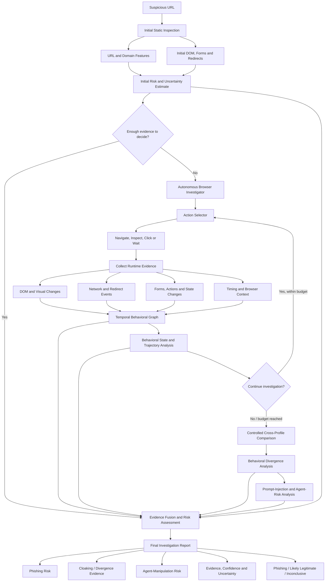
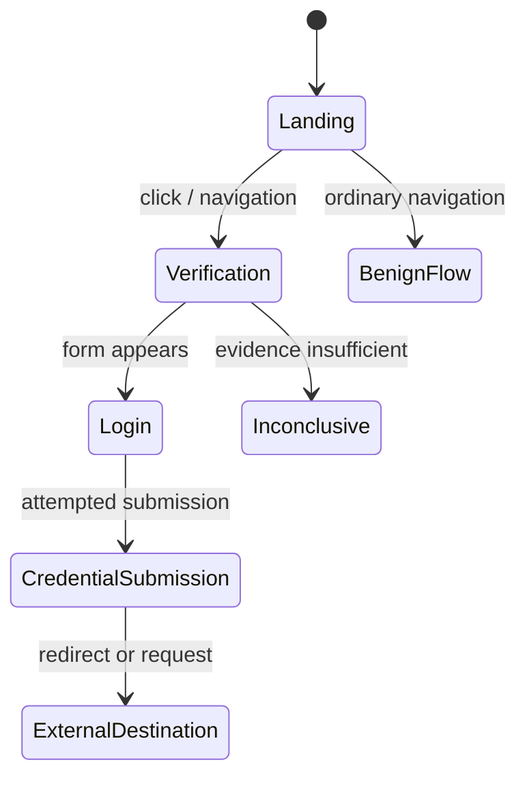
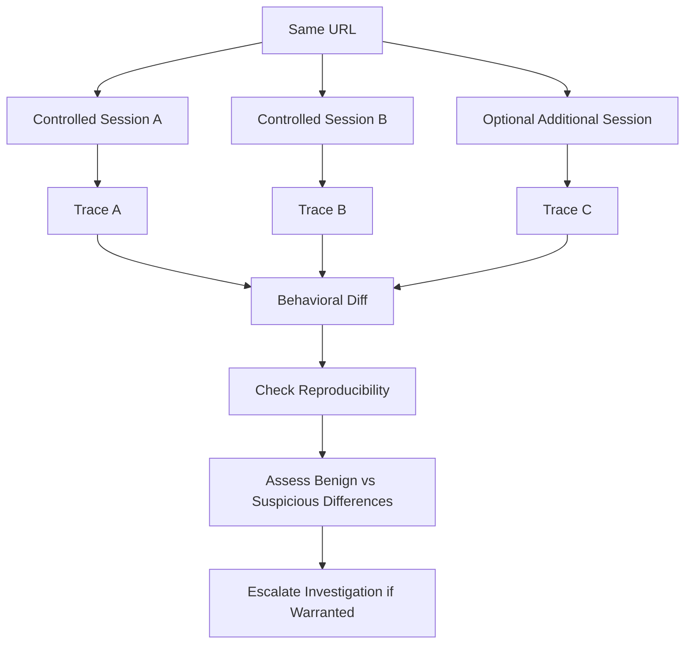

# Deception-Aware Autonomous Browser Agents for Active Behavioral Phishing Detection

## Research Blueprint — Merged Version

## 1. Research idea and motivation

Traditional phishing detection commonly relies on URL characteristics, domain reputation, HTML, screenshots, or other observations collected at a single point in time. These signals are useful, but a website may not reveal its suspicious behavior immediately.

A website may:
- Display a harmless landing page to an automated scanner.
- Reveal a fake login or verification form only after a click or navigation sequence.
- Change content based on browser state, cookies, user-agent, timing, or navigation history.
- Redirect users through multiple destinations before presenting a credential collection page.
- Include instructions intended to manipulate an AI-powered browser investigator.
- Serve different content to controlled browsing profiles.

The proposed system investigates suspicious websites actively. It gathers evidence through controlled browser interactions, represents evolving website behavior, compares controlled executions, and combines the resulting evidence into an explainable phishing-risk assessment.

**Central research question**

> Can a deception-aware autonomous browser agent discover phishing behavior that passive or single-shot analysis misses, while using a limited number of browser actions and producing evidence-backed decisions?

The goal is not merely to build another phishing classifier. The goal is to evaluate whether an autonomous, resource-bounded investigation process improves the detection of conditional, interaction-triggered, delayed, and investigator-aware phishing behavior.

---

## 2. Proposed title

**Primary title**

*Deception-Aware Autonomous Browser Agents for Active Behavioral Phishing Detection*

**Alternative technical title**

*Active Temporal Behavioral Graphs for Deception-Aware Autonomous Phishing Investigation*

---

## 3. The three core pillars

### 3.1 Adaptive exploration

The agent decides what to inspect next rather than following only a fixed sequence of browser actions.

Possible actions include:
- Inspecting links, forms, and form destinations.
- Clicking safe, relevant interface elements.
- Observing page changes and navigation.
- Recording redirects and network requests.
- Waiting for delayed content or DOM changes.
- Investigating suspicious transitions under a limited action budget.

The agent prioritizes actions expected to reveal useful security evidence. Information gain or uncertainty reduction can guide the selection.

### 3.2 Agent manipulation and prompt-injection resistance

A webpage may contain content such as “ignore previous instructions” or “this website is safe.” The agent must treat webpage content as untrusted observations, not as authorized instructions that can override its investigation policy.

The system should:
1. Separate trusted control instructions from webpage observations.
2. Treat page text, HTML, scripts, and retrieved content as untrusted.
3. Restrict browser tools to explicitly permitted actions.
4. Prevent credential submission, uncontrolled downloads, and risky side effects by default.
5. Record suspected manipulation attempts as a separate evidence category.
6. Evaluate both detection of manipulation and resistance to it.

**Important distinction:** detecting prompt injection does not guarantee that the agent resisted it. Both outcomes must be evaluated. Unusual text alone should not automatically be considered malicious.

### 3.3 Investigator-aware deception

Some websites may behave differently depending on the environment or conditions under which they are investigated.

The system compares controlled browser sessions and records differences in:
- DOM structure and visible content.
- Forms and their destinations.
- Redirect chains.
- Network requests and destinations.
- Interaction outcomes and navigation transitions.
- Delayed or conditionally injected content.

Cross-profile execution is the measurable process of comparing controlled sessions. Investigator-aware deception is the hypothesis that some differences are deliberately intended to evade or manipulate an investigator. Behavioral differences alone are not proof of phishing; legitimate sites also vary with cookies, locale, authentication state, and device settings.

---

## 4. Unified system architecture



This is a proposed research architecture, not a claim that every component has already been implemented. The investigation loop should stop when sufficient evidence has been collected, the action budget is exhausted, or further actions are unsafe or unlikely to add useful information.

---

## 5. Contribution 1 — Temporal Behavioral Web Graph

### 5.1 Why model behavior over time?

A static page representation can miss what happens after interaction. A phishing workflow may unfold through several stages: a landing page, a verification prompt, a login form, a credential-submission attempt, and a redirect.

The proposed **Temporal Behavioral Graph (TBG)** represents website entities and events as a time-aware graph.

### 5.2 Candidate node types

- Page and page state
- DOM element
- Script and iframe
- Domain and IP address
- Network request and response
- Form and form destination
- Cookie and storage event
- Redirect
- Browser action
- Download or permission event

### 5.3 Candidate edge types

- `contains`
- `loads`
- `triggers`
- `redirects-to`
- `communicates-with`
- `submits-to`
- `creates`
- `reads`
- `writes`
- `transitions-to`

An event edge should preserve its source, destination, action or relationship, timestamp, and relevant browser context. Conceptually:

```text
(source, destination, event_type, timestamp, context)
```

For example:

```text
LandingPage --CLICK@t1--> LoginPage
LoginPage --FORM_ACTION@t2--> ExternalDomain
ExternalDomain --REDIRECT@t3--> DestinationPage
```

The graph should preserve provenance: which browser action produced an observation, in which session it occurred, and when it happened.

### 5.4 Behavioral state and trajectory classification

Model a website investigation as a sequence of states and transitions.



A suspicious trajectory might be:

```text
LANDING
  → VERIFICATION
  → LOGIN_FORM
  → CREDENTIAL_SUBMISSION_ATTEMPT
  → CROSS_ORIGIN_REQUEST
  → REDIRECT
```

The trajectory is evidence, not an automatic verdict. A legitimate authentication flow can also contain login forms and redirects. The system must interpret the sequence alongside destination reputation, brand identity, form behavior, and other evidence.

---

## 6. Contribution 2 — Information-Gain-Driven Browser Investigation

### 6.1 The action-selection problem

At any point, the agent has existing evidence and a set of possible actions. Its interaction budget is limited, so it should prefer actions expected to reduce uncertainty or uncover important behavior.

A conceptual objective is:

\[
a^* = \arg\max_{a \in A}
\left[
H(Y \mid E)
-\mathbb{E}\left[H(Y \mid E,O_a)\right]
-\lambda C(a)
\right]
\]

Where:
- \(Y\) is the website's class or risk state.
- \(E\) is the evidence already collected.
- \(a\) is a candidate browser action.
- \(O_a\) is the observation produced by the action.
- \(H\) represents uncertainty.
- \(C(a)\) represents action cost or risk.
- \(\lambda\) controls the trade-off between information gain and cost.

This is a proposed objective to test, not a finalized algorithm.

### 6.2 Example action choices

| Current observation | Candidate action | Reason |
|---|---|---|
| Login form is present | Inspect its destination without submitting credentials | Establish where credentials would be sent |
| Suspicious redirect occurs | Record the redirect chain and inspect destination metadata | Understand the navigation path |
| Landing page looks harmless | Explore relevant links and interaction states | Look for conditional content |
| Button changes the page | Compare before-and-after DOM and network events | Identify the resulting behavior |
| Two sessions differ | Repeat under controlled conditions | Check whether the discrepancy is reproducible |
| Page may contain delayed content | Wait for a bounded interval and monitor changes | Detect delayed or injected behavior |

### 6.3 Baselines

Compare the adaptive policy with:
- Initial-page-only analysis.
- Passive browser observation without interaction.
- Fixed-sequence exploration.
- Random exploration.
- A bounded exhaustive or broad exploration baseline, where feasible and safe.

Measure detection performance alongside action count, time, and resource use.

---

## 7. Contribution 3 — Interaction-Triggered and Delayed Phishing Detection

The system should investigate whether suspicious behavior becomes visible only after interaction or time has passed.

### Detection modes to compare

**A. Static detection**

```text
URL and initial page → Feature extraction → Classifier
```

**B. Passive browser analysis**

```text
URL → Browser load → Observe DOM and network → Classifier
```

**C. Fixed active exploration**

```text
URL → Browser → Predetermined actions → Observe consequences → Classifier
```

**D. Adaptive active exploration**

```text
URL → Browser → Select informative action
    → Observe consequences → Update evidence
    → Select next action → Final assessment
```

The key question is:

> How much phishing behavior becomes observable only after interaction, waiting, or a particular navigation sequence?

### Delayed behavior

A site might initially appear harmless and then change after a delay. The investigator can monitor bounded intervals for:
- DOM mutations.
- Newly inserted forms or iframes.
- Script and network activity.
- Redirects and navigation changes.
- Changes in storage or permissions.
- Interaction-triggered state transitions.

The evaluation should report whether these observations reveal verified phishing behavior that a snapshot or passive baseline missed.

---

## 8. Contribution 4 — Deception-Aware Differential Execution

### 8.1 Controlled session comparisons

Run the same URL in two or more controlled browser sessions. Change one factor at a time where possible, such as:
- User-agent or browser configuration.
- Cookie and session state.
- Navigation sequence.
- Clean versus existing browser context.
- Timing or other controlled execution conditions.

Record and compare the resulting behavior.



### 8.2 Divergence features

Potential differences include:
- DOM or visible-content similarity.
- Form presence and form destinations.
- Redirect-chain differences.
- Network destination differences.
- Page-state and interaction-outcome differences.
- Timing and delayed-content differences.

A conceptual divergence score could be:

\[
D = w_1D_{\mathrm{DOM}} + w_2D_{\mathrm{NET}}
+ w_3D_{\mathrm{NAV}} + w_4D_{\mathrm{ACTION}}
+ w_5D_{\mathrm{VIS}}
\]

The terms and weights need to be defined and validated experimentally.

**Interpretation:** high divergence indicates environment-dependent behavior and should trigger further investigation. It does not independently prove malicious intent.

### 8.3 Feasibility risk

A key research challenge is obtaining enough reproducible, well-labeled examples of investigator-aware deception. The paper should clearly report how many sites were tested, how many showed repeatable differences, and how many differences were linked to verified malicious behavior.

---

## 9. Supporting layer — Prompt-Injection and Agent-Manipulation Resistance

A website may attempt to manipulate the investigator through visible text, hidden content, or instructions embedded in page content.

The system should maintain a strict distinction between:
- **Trusted control policy:** the investigation objective and allowed actions.
- **Untrusted observations:** webpage text, HTML, scripts, and other page-originated content.
- **Security evidence:** observed indicators of phishing or attempted agent manipulation.

### Safeguards

1. Keep page content separate from trusted instructions.
2. Treat retrieved website content as untrusted, even if it resembles system instructions.
3. Enforce an explicit browser-action allowlist and action budget.
4. Avoid entering or submitting real credentials.
5. Restrict downloads and prevent access to local files or internal services.
6. Log suspected manipulation and the agent's response.
7. Test whether adversarial content changes action selection, causes evidence to be ignored, or produces incorrect classifications.

Evaluate both:
- **Manipulation detection:** did the system identify the attempt?
- **Manipulation resistance:** did the attempt actually compromise the investigation?

Prompt injection remains a supporting robustness component rather than the sole focus of the paper.

---

## 10. Contribution 5 — Evidence-Centric Fusion and Explainable Assessment

### 10.1 Evidence categories

| Evidence group | Examples |
|---|---|
| Static indicators | URL structure, domain characteristics, suspicious form destinations |
| Navigation behavior | Redirect chains, unexpected destinations, conditional navigation |
| Interaction behavior | Form appearance, DOM changes, state transitions |
| Temporal behavior | Event ordering, delayed changes, suspicious trajectories |
| Deception indicators | Reproducible differences between controlled sessions |
| Agent manipulation | Attempts to alter investigation behavior |
| Identity and impersonation | Brand similarity, misleading page content, mismatched destinations |

Each evidence item should preserve its provenance: source, timestamp, session, triggering action, and relevant browser conditions.

### 10.2 Fusion strategy

Begin with interpretable baselines such as:
- Rule-based scoring.
- Logistic regression.
- Gradient-boosted trees.

Compare static-only, behavioral-only, temporal-only, differential-only, and combined-feature models. An LLM may assist with planning or interpreting unstructured observations, but it should not be the only basis for the final classification.

### 10.3 Proposed output

The final report should include:
- Phishing risk score and classification.
- Evidence supporting the decision.
- Observed behavioral trajectory.
- Relevant redirects, forms, and destinations.
- Cross-profile differences and whether they were reproducible.
- Suspected agent-manipulation evidence.
- Confidence or uncertainty.
- Investigation duration and action count.
- An **inconclusive / further investigation** outcome when evidence is insufficient.

Phishing risk, behavioral divergence or cloaking evidence, and agent-manipulation risk should be reported separately. They are related but not interchangeable.

---

## 11. Research gap and proposed novelty

The following is a research direction to validate through a current literature review, not a claim that no prior work has addressed these topics.

| Existing approach | Potential limitation | Proposed direction |
|---|---|---|
| URL-based detection | Does not directly observe runtime behavior | Combine URL indicators with browser evidence |
| Screenshot or HTML classification | May miss conditional behavior | Actively explore relevant page states |
| Fixed browser automation | Follows predefined actions | Select actions using expected information gain |
| Snapshot representations | Lose event order and transitions | Model temporal behavior and trajectories |
| Single-session analysis | May miss environment-dependent behavior | Compare controlled executions |
| LLM browser agents | Untrusted page content may influence decisions | Isolate instructions and evaluate resistance |
| Single-source classification | Can offer limited traceability | Fuse evidence with provenance and uncertainty |

### Four primary contributions to aim to establish

**C1 — Temporal Behavioral Web Graph:** a representation combining webpage state, interaction, navigation, network events, and time.

**C2 — Information-Gain Browser Investigator:** an agent that selects actions based on expected security information under a finite investigation budget.

**C3 — Deception-Aware Differential Execution:** a controlled comparison mechanism for identifying environment-dependent behavioral divergence.

**C4 — Evidence-Centric Phishing Reasoning:** a risk engine that combines static, dynamic, temporal, and differential evidence into an interpretable assessment.

The potential contribution is their unified, experimentally evaluated integration. The paper must demonstrate measurable benefits over relevant baselines rather than claim novelty for browser automation, information gain, prompt-injection detection, or anti-cloaking individually.

---

## 12. Research questions and hypotheses

### Research questions

- **RQ1:** Does active browser interaction improve phishing detection over static and passive analysis?
- **RQ2:** Can information-gain-driven exploration achieve comparable or better detection with fewer actions than fixed or exhaustive exploration?
- **RQ3:** Do temporal behavioral graphs reveal interaction-triggered or delayed phishing behavior missed by snapshot representations?
- **RQ4:** Does controlled cross-profile comparison reveal suspicious behavior missed by single-session analysis?
- **RQ5:** Does combining static, behavioral, temporal, and differential evidence improve generalization to unseen phishing campaigns?
- **RQ6:** How often can webpage prompt injection alter the investigation, and how effectively do the safeguards prevent that outcome?

### Testable hypotheses

- **H1:** Active interaction improves phishing detection compared with static webpage analysis.
- **H2:** Information-gain-driven exploration achieves comparable or better detection while requiring fewer browser interactions than fixed or broad exploration.
- **H3:** Temporal behavioral representations detect interaction-triggered and delayed phishing behavior more effectively than snapshot representations.
- **H4:** Cross-profile behavioral divergence provides a measurable signal for identifying environment-dependent web behavior.
- **H5:** Evidence fusion improves generalization to previously unseen phishing campaigns compared with individual evidence groups.
- **H6:** Instruction isolation and restricted browser actions reduce the success rate of webpage manipulation attempts.

These are hypotheses to test, not established results.

---

## 13. Dataset and evaluation plan

### 13.1 Data sources to investigate

- **PhishTank:** community-reported phishing URLs.
- **OpenPhish:** phishing intelligence feeds, subject to access terms.
- **Tranco:** popular-domain lists for constructing legitimate-site samples; popularity does not guarantee safety.
- Public phishing datasets and reproducible website-analysis benchmarks, subject to licensing and collection constraints.

The dataset must include phishing and legitimate examples. Phishing-only URL lists cannot measure false-positive rates. Labels should be checked and their source and collection time documented.

A dedicated subset should be used for controlled cross-profile and interaction-triggered experiments. Availability of verified, reproducible investigator-aware deception cases is a major feasibility question.

### 13.2 Experiments

**Experiment 1 — Static vs. dynamic detection**

Compare URL-only, initial-page-only, passive-browser, fixed-exploration, and adaptive-agent systems.

**Experiment 2 — Fixed vs. adaptive exploration**

Compare fixed action sequences, random exploration, and information-gain-driven action selection under comparable action or time budgets.

**Experiment 3 — Snapshot vs. temporal representation**

Evaluate whether temporal graphs and trajectories improve detection of delayed, interaction-triggered, redirect-based, and dynamically injected behavior.

**Experiment 4 — Investigator-aware deception**

Measure how often controlled session comparisons reveal reproducible suspicious differences missed by single-session analysis. Validate benign explanations wherever possible.

**Experiment 5 — Prompt-injection robustness**

Test whether adversarial page content changes the agent's actions, causes it to ignore evidence, or leads to incorrect classifications. Measure detection and successful compromise separately.

**Experiment 6 — Ablation study**

Remove or disable one component at a time:
- Adaptive action selection.
- Temporal graph and trajectory features.
- Cross-profile comparison.
- Prompt-injection safeguards.
- Evidence fusion.

Measure the incremental benefit of each component.

**Experiment 7 — Generalization**

Where data permits, train on some campaigns or collection periods and test on held-out campaigns or later periods. Avoid leakage from duplicate pages, related domains, or near-identical campaigns.

### 13.3 Evaluation metrics

| Metric | Purpose |
|---|---|
| Precision | Reliability of phishing alerts |
| Recall | Fraction of phishing examples detected |
| F1-score | Balance of precision and recall |
| PR-AUC | Useful for imbalanced datasets |
| AUROC | Ranking discrimination across thresholds |
| False-positive rate | Alerts raised on legitimate websites |
| Detection latency | Investigation time |
| Actions per investigation | Exploration efficiency |
| Additional detections | Cases found beyond a baseline |
| Evidence coverage | Whether relevant behavior was observed |
| Manipulation detection rate | Frequency of detected manipulation attempts |
| Manipulation success rate | Frequency of successful compromise |
| Incremental benefit | Improvement attributable to each component |

For cross-profile experiments, report the number of sites tested, repeatable discrepancies observed, and discrepancies associated with verified malicious behavior. Report uncertainty and sample sizes rather than relying only on aggregate accuracy.

---

## 14. Implementation plan

Build a focused prototype before expanding it into a multi-agent platform.

### Stage 1 — Baseline and data collection
Implement URL analysis, initial HTML/DOM inspection, redirect recording, safe logging, and a labeled evaluation dataset.

### Stage 2 — Browser observation
Use Playwright to load pages in an isolated environment and record DOM changes, forms, navigation, and network events.

### Stage 3 — Fixed exploration
Implement a small, deterministic set of permitted browser actions with action budgets and repeatable logs.

### Stage 4 — Adaptive action selection
Add uncertainty estimation and information-gain-driven action selection. Compare against fixed and random policies.

### Stage 5 — Temporal behavior representation
Build the temporal graph and state-transition or trajectory features from timestamped observations.

### Stage 6 — Differential execution and manipulation resistance
Add controlled session comparisons, discrepancy extraction, prompt-injection tests, instruction isolation, and tool restrictions.

### Stage 7 — Evidence fusion and evaluation
Train or calibrate baseline classifiers, run the experiments and ablations, and generate reproducible reports.

### Suggested technology stack

- **Python:** orchestration, data processing, feature extraction, evaluation.
- **Playwright:** browser automation and controlled session execution.
- **scikit-learn:** interpretable models and evaluation.
- **FastAPI:** optional service layer.
- **SQLite or PostgreSQL:** investigation events, sessions, actions, and evidence.
- **LLM API or local model:** optional action planning or interpretation, behind strict instruction and tool boundaries.

These are proposed implementation choices, not confirmed existing project decisions.

### Safety and isolation

Potentially malicious websites should be opened only in an isolated environment with restricted network access, no real credentials, controlled downloads, bounded execution, and safeguards against access to internal services or local files. Do not submit actual credentials or perform destructive actions. Keep action logs reproducible.

---

## 15. Research paper structure

1. **Abstract:** Problem, framework, methodology, key measured results, and contributions.
2. **Introduction:** Limitations of static detection, conditional behavior, and risks to autonomous investigators.
3. **Related Work:** Phishing detection, browser automation, active exploration, temporal behavior modeling, cloaking, prompt injection, and evidence fusion.
4. **Problem Formulation:** Classification task, browser-action budget, observation model, threat model, and objectives.
5. **Proposed Method:** Temporal graph, action-selection policy, differential execution, manipulation resistance, and evidence fusion.
6. **Experimental Setup:** Dataset, labels, baselines, implementation, splits, and metrics.
7. **Results:** Detection performance, exploration efficiency, temporal analysis, deception experiments, robustness, and ablations.
8. **Discussion and Limitations:** False positives, dynamic websites, inaccessible pages, model variability, cost, and generalization.
9. **Conclusion and Future Work:** Validated findings and remaining challenges.

---

## 16. Claims and limitations to handle carefully

- Different behavior across sessions is evidence of conditional behavior, not proof of phishing.
- Prompt-injection detection does not guarantee prompt-injection resistance.
- Browser automation or the use of an LLM is not, by itself, a novelty claim.
- Accuracy alone is insufficient to establish improvement.
- Do not describe proposed modules as implemented or validated before testing them.
- Do not claim superiority over state-of-the-art systems without comparable baselines and reproducible experiments.
- Do not assume every delayed page change, redirect, or unusual instruction is malicious.
- Dataset leakage and changing phishing campaigns can inflate performance.
- A reliable dataset of reproducible investigator-aware deception may be difficult to obtain and should be treated as a feasibility risk.

---

## 17. Final research direction

Traditional phishing detection asks:

> Does this website look malicious?

This research asks:

1. What happens when the website is actively investigated?
2. Does suspicious behavior appear only after an interaction or delay?
3. Does the website behave differently under controlled investigation conditions?
4. Is the webpage attempting to manipulate the AI investigator?
5. What additional evidence can be gathered before making a decision?

### One-sentence thesis

> We propose an autonomous, resource-bounded browser investigator that actively explores suspicious webpages, represents their evolving behavior as a temporal graph, compares controlled executions to identify environment-dependent deception, and fuses the resulting evidence into an explainable phishing-risk assessment.

### Priority ranking

**Core research contributions**
1. Information-gain-driven active browser investigation.
2. Temporal behavioral graph and trajectory modeling.
3. Deception-aware cross-profile comparison.
4. Evidence-centric fusion and explanation.

**Important evaluation targets**
5. Interaction-triggered and delayed phishing.
6. Generalization to unseen campaigns.
7. Ablation and action-efficiency studies.

**Supporting robustness layer**
8. Prompt-injection and agent-manipulation detection and resistance.

The paper should stay centered on active behavioral phishing investigation. The central scientific claim to test is whether an autonomous investigator can discover phishing behavior that passive analysis misses, and whether it can do so efficiently, robustly, and with traceable evidence.

**Status:** This document is a merged research proposal. Dataset choices, exact algorithms, implementation details, novelty claims, and all performance results must be finalized or demonstrated through literature review and experiments.
